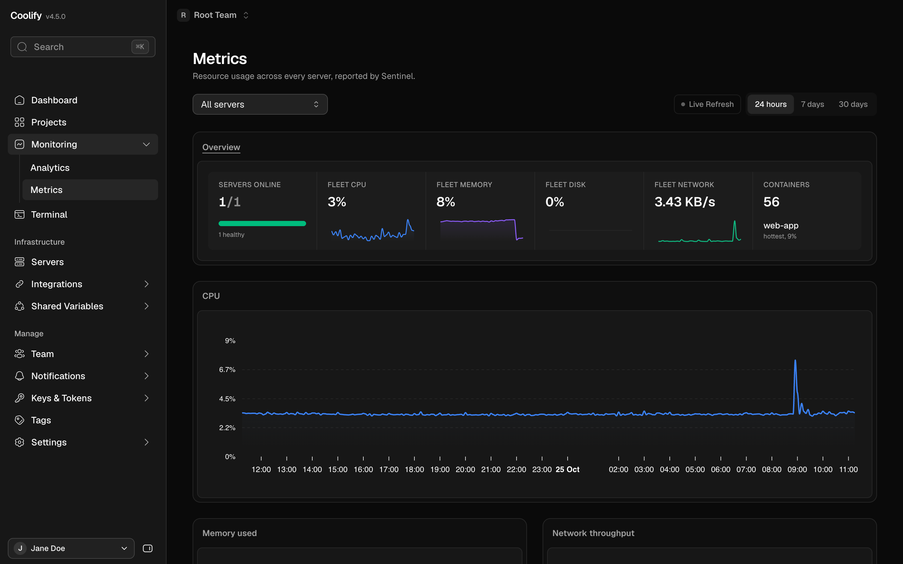
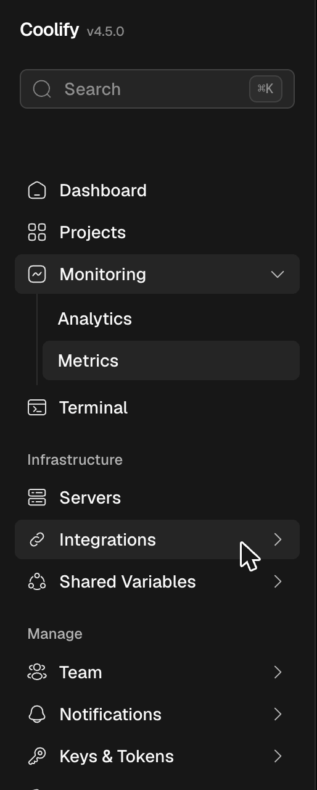

# Coolify theme

A neutral, shadcn-style theme for [Coolify](https://coolify.io) with an accordion sidebar. A Cloudflare Snippet injects it, so you don't need to fork or rebuild Coolify.





## What you get

- Neutral colors in dark and light mode, no purple
- Flat buttons, white/black primary buttons
- A wider sidebar where submenus open in place, on desktop and mobile
- Flat nav items by default (you can still pick 3D under Appearance)

## Install

Your Coolify domain needs to be on Cloudflare, on a plan with Snippets (Pro or higher).

1. Go to **Rules → Snippets → Create Snippet** in your zone.
2. Paste one of these:
   - [`dist/loader.js`](dist/loader.js) stays up to date and picks the build for your Coolify version.
   - [`dist/latest/snippet.js`](dist/latest/snippet.js) has everything inline and fetches nothing. Use it if you'd rather not run code from this repo.
3. Set the snippet rule, with your own host:
   ```
   (http.host eq "coolify.example.com" and any(http.request.headers["accept"][*] contains "text/html"))
   ```

No Cloudflare? Load [`dist/latest/style.css`](dist/latest/style.css) with a user-style extension like Stylus. You get the look, but not the accordion.

## Versions

Each build lives in `dist/<coolify-version>/` and covers that Coolify version and the ones after it, until the next build. The loader picks the newest build at or below your version, so older installs keep a build that fits.

New builds only happen when a Coolify release breaks something, and fixes go into the newest build. Every build is tagged `coolify-<version>` so you can browse or compare its source.

## Development

```
bun run build.ts 4.5.0
```

This builds `src/` into `dist/4.5.0/` and `dist/latest/`. Commit and push, and GitHub Pages deploys it.

When Coolify releases a new version, a daily check opens an issue. If the theme still works, close it. If not, fix `src/`, build the new version and push.

Colors live in [`src/css/tokens.css`](src/css/tokens.css). To run your own variant, fork the repo and point `THEME_URL` in `src/loader.js` at your fork's Pages.

<details>
<summary>Patching an older build</summary>

`build.ts` won't rebuild an older version from the current `src/`, so patch it from its tag:

```
git worktree add ../coolify-theme-4.5.0 coolify-4.5.0
cd ../coolify-theme-4.5.0 && git switch -c patch-4.5.0
# fix src/, then
bun run build.ts 4.5.0 && git commit -am "fix(4.5.0): what you fixed"
git tag -f coolify-4.5.0 && git push -f origin coolify-4.5.0

cd - && git checkout patch-4.5.0 -- dist/4.5.0
git commit -m "fix(4.5.0): what you fixed" && git push
git worktree remove ../coolify-theme-4.5.0 && git branch -D patch-4.5.0
```

</details>
